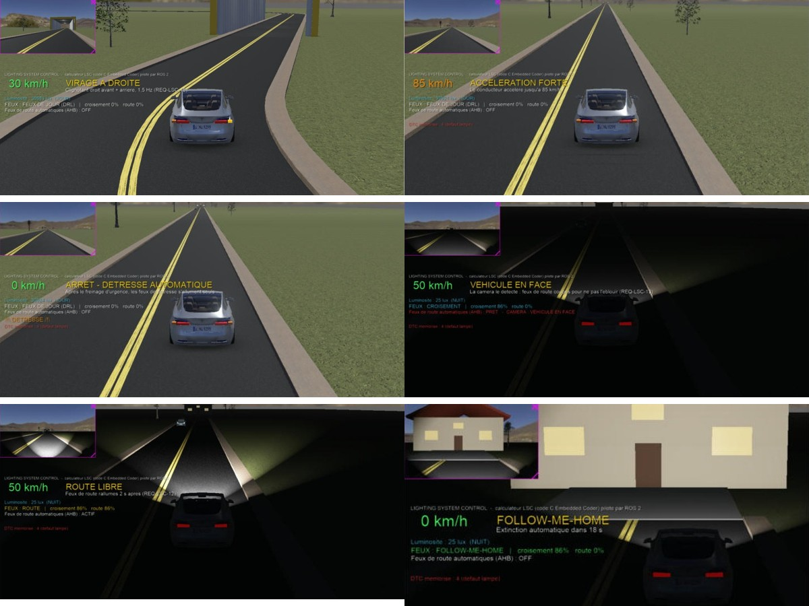
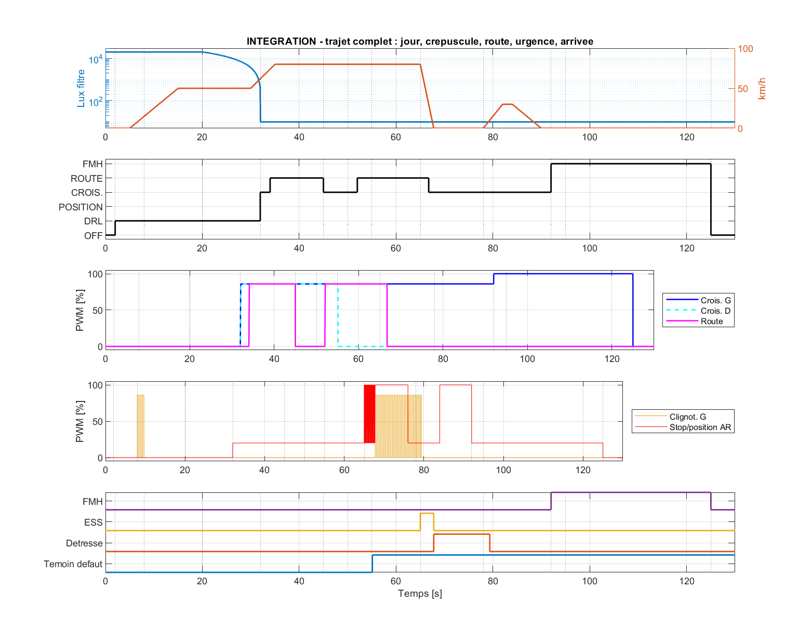
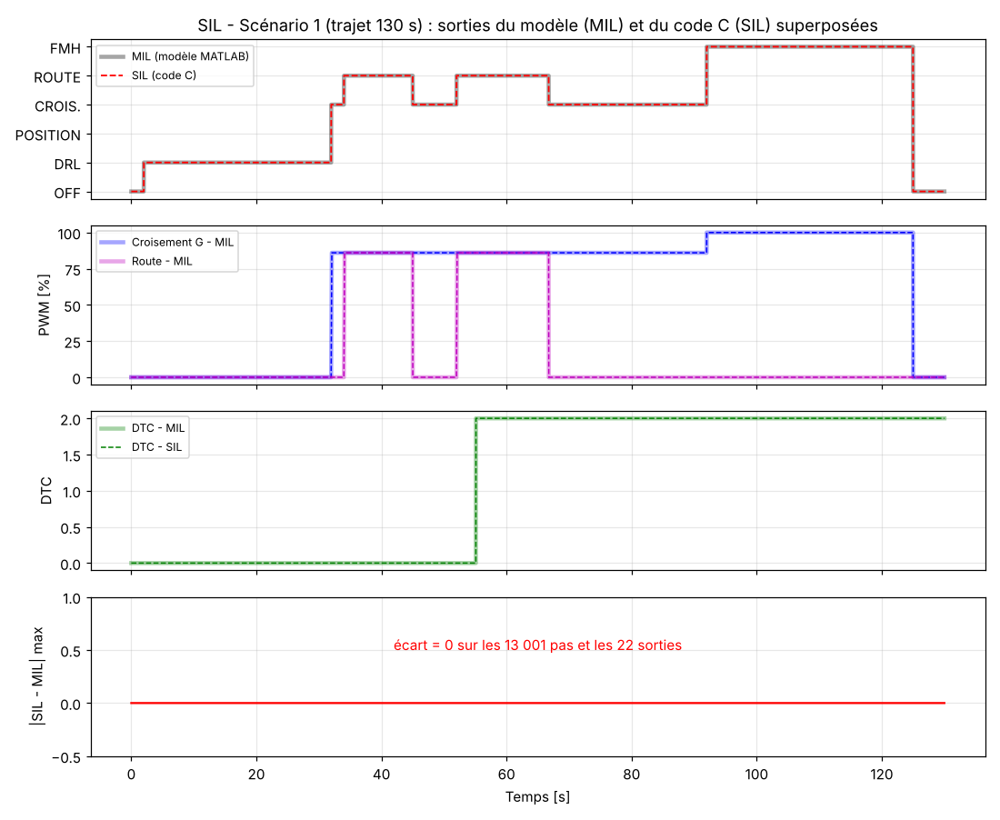

# Lighting System Control (LSC) – ECU d'éclairage automobile

Calculateur d'éclairage extérieur d'un véhicule, conçu en **MATLAB/Simulink**, vérifié en **MIL** puis en **SIL** (code C généré par Embedded Coder), et intégré dans un **véhicule virtuel ROS 2 + Webots**.

Le projet suit un cycle en V : cahier des charges (exigences `REQ-LSC-xx`) → modèles Simulink par bloc → intégration → génération de code → tests back-to-back MIL/SIL → validation sur simulateur.



## Architecture fonctionnelle

| Bloc | Fonction |
|------|----------|
| **B1** Acquisition | Filtrage du capteur de luminosité, détection de message absent, anti-rebond des entrées |
| **B2** AutoHeadlamp | Allumage automatique des feux (crépuscule, tunnel), avec hystérésis et temporisations |
| **B3** AHB | Feux de route automatiques (vitesse, nuit, véhicule en face, panne caméra, appel de phares) |
| **B4** Lighting Manager | Arbitrage des feux (DRL, position, croisement, route, brouillard) |
| **B5** Signalisation | Clignotants (impulsion confort), détresse, hyper-clignotement, feux stop d'urgence (ESS) |
| **B6** Diagnostic | Détection de lampe grillée ou court-circuit, mémorisation des DTC |
| **B7** Pilotage | Commande PWM des lampes, compensation de tension, allumage progressif |
| **B8** Follow-me-home | Éclairage d'accompagnement après coupure du contact |

Tous les blocs sont réunis dans `LSC_Integration.slx`, avec un modèle de lampes (plant).

## Organisation du dépôt

```
.
├── B1_Acquisition.slx … B7_Driver.slx   Modèles Simulink par bloc
├── LSC_Integration.slx                  Modèle intégré (ECU complet)
├── build_*.m                            Scripts qui construisent et simulent chaque modèle
├── run_*.m, run_int_scenarios.m         Lancement des simulations et scénarios d'intégration
├── sil_all.m, sil_B2*.m                 Génération de code et tests back-to-back MIL/SIL
├── LSC_cmd.m, LSC_diag.m                Runnables de l'ECU (fonctions générées en C)
├── scripts/                             Paramètres, logique des blocs et scénarios de test
├── sil/                                 Banc SIL (harness C, données d'entrée, sorties MIL/SIL)
├── ros2_pkgs/
│   ├── lsc_ecu/                         Nœud ROS 2 C++ qui embarque le code C généré
│   └── lsc_virtual/                     Véhicule Webots, tableau de bord, scénarios automatiques
├── results/                             Résultats des tests (MIL, SIL, virtualisation, démo)
├── images/                              Figures et captures
└── docs/                                Cahier des charges et guides illustrés
```

## Résultats

| Niveau | Résultat |
|--------|----------|
| **MIL**: simulation Simulink par bloc et intégrée | Scénarios jour/tunnel/nuit/caméra/batterie validés |
| **SIL**: back-to-back MIL vs code C | 4 scénarios, 0 écart sur 22 sorties, test de mutation détecté |
| **Virtualisation**: ROS 2 + Webots, trajet complet | **17 / 17 PASS** |
| **Démonstration**: virages, tunnel, ESS, nuit, maison | **15 / 15 PASS** |

<p>
  
  
</p>

## Lancer le projet

### 1. MATLAB / Simulink (R2022b)
Ouvrir MATLAB **dans le dossier du projet**, puis :

```matlab
build_B1_Acquisition      % idem pour B2 ... B7
build_LSC_Integration     % modèle intégré
run_int_scenarios         % scénarios tunnel, caméra, batterie
sil_all                   % génération de code + tests MIL/SIL (Embedded Coder)
```

### 2. ROS 2 + Webots (Ubuntu / WSL)
Prérequis : ROS 2, Webots et `webots_ros2`.

```bash
./demo.sh                 # construit les paquets et lance la démonstration complète
```

Le détail des commandes (mondes, tableau de bord, commandes conducteur) se trouve dans [`ros2_pkgs/README_LANCEMENT.md`](ros2_pkgs/README_LANCEMENT.md).
Les résultats sont écrits dans le dossier indiqué par la variable `LSC_RESULTS` (par défaut `~/lsc_results`).

## Outils
MATLAB/Simulink R2022b · MATLAB Coder / Embedded Coder · C · C++ · Python · ROS 2 · Webots

## Auteurs
Amina Borcheni & Nessrine Abid
